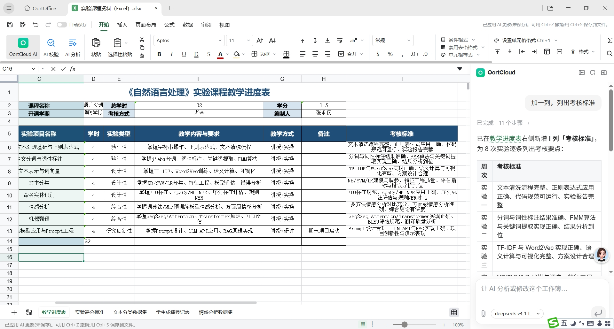

<div align="center">

# OortOffice

**把整套 Office 装进桌面，再把 AI 助手放进侧边栏。**

文字处理 · 电子表格 · 演示文稿 · PDF · AI 总结 / 润色 / 排版

[](#系统要求)
[](#路线图)
[](#ai-智能总结)
[](#许可证)

[产品亮点](#产品亮点) · [界面预览](#界面预览) · [功能清单](#功能清单) · [AI 智能总结](#ai-智能总结) · [快速开始](#快速开始) · [路线图](#路线图)

**简体中文** | [English](./README.md)

</div>

---

## 产品亮点

OortOffice 是一款原生桌面办公套件。它把 Word、Excel、PowerPoint、PDF 的**全部常用功能点**整合进同一个应用：同一套功能区、同一套文件管理、同一套快捷键，文档之间可以自由复制粘贴与互相引用，不需要在多个窗口之间来回切换。

在完整办公能力之上，OortOffice 加入了 **OortCloud AI 助手**，其中最具代表性的是 **AI 智能总结**——你在侧边栏问一句"总结这篇文档的主要内容和要点"，AI 就会读取当前打开的文档，并把结果整理成分级的结构化摘要，直接显示在侧边栏中，与正文并排对照阅读。

- **一套应用，四种文档**：文字、表格、演示、PDF 共用同一套界面与账户体系。
- **完整的传统功能区**：文件 / 开始 / 插入 / 绘图 / 设计 / 布局 / 引用 / 审阅 / 视图，逐项对齐 Office 的操作习惯。
- **AI 就在文档旁边**：总结、润色、排版、问答全部在侧边栏完成，不跳转、不复制粘贴。
- **修订追踪**：所有 AI 改动可先进入修订模式，人工确认后再接受。
- **自动保存 + 云端协同**：本地实时落盘，登录后自动同步，支持多人同时编辑。

---

## 界面预览


> 左侧是 **OortCloud** 侧边栏：输入诉求后，AI 直接对当前打开的 `论坛问题.docx` 做总结，输出按「功能缺陷 / 功能删减与简化」等类别分层的结果，并标注每一条对应的原文位置（如"块0""块4""块13"），点击即可跳转到正文对应段落。右侧是标准文档编辑区，顶部功能区提供 AI 总结、AI 润色、AI 排版 三个入口。





---

## 功能清单

### 文字处理（对应 Word）

- 富文本编辑：字体、字号、加粗 / 斜体 / 下划线、删除线、上标下标、字体颜色与高亮。
- 段落排版：多级项目符号与编号、缩进、行距段距、中文版式、首行缩进。
- 样式体系：内置标题 / 正文样式，**样式窗格**可视化改样式，全文档一键套用。
- 页面能力：分页分节、页眉页脚、页码、分栏、页面边框与水印、标尺与打印预览。
- 引用能力：目录自动生成、脚注尾注、题注与交叉引用、参考文献与引文管理。
- 审阅能力：**修订追踪**、批注、接受 / 拒绝修订、文档比较与合并、限制编辑。
- 表格与图文：单元格合并拆分、表格样式、图片 / 形状 / SmartArt / 图表 / 文本框混排、环绕方式与对齐。
- 查找替换：支持通配符与正则、格式查找。

### 电子表格（对应 Excel）

- 千万行级网格虚拟滚动，冻结窗格、分组分级、多工作表与跨表引用。
- 完整函数库：数学统计、文本、日期时间、查找引用、逻辑、财务、工程函数。
- 数据能力：排序筛选、条件格式、数据验证、分列、删除重复项。
- 透视表与透视图、迷你图、数据透视图表联动。
- 图表全家桶：柱 / 折线 / 饼 / 条形 / 面积 / 散点 / 雷达 / 组合图，样式与数据标签可精细调控。
- 公式栏、名称管理器、迭代计算、模拟分析与单变量求解。

### 演示文稿（对应 PowerPoint）

- 幻灯片母版与版式、节管理、拖拽式缩略图排序。
- 版式化排版建议、对齐吸附与智能参考线、选择窗格与图层管理。
- 切换效果、动画时间轴、自定义放映、排练计时。
- 演讲者视图、演示者备注、激光笔与墨迹标注。

### PDF 与通用能力

- PDF 阅读、批注、书签、页面管理（拆分 / 合并 / 旋转 / 重排）。
- Office 文档与 PDF 互转，扫描件 OCR 文字识别。
- 版本历史与时间线回溯、自动保存与崩溃恢复。
- 多标签页工作区：一个窗口内并行打开多份文档，标签可拖拽成新窗口。

---

## AI 智能总结

这是 OortOffice 1.0 的主打新功能：**把"读一遍再总结"这件事交给侧边栏里的 AI**。

### 怎么用

1. 打开任意文档（Word / PDF / 表格 / 演示均可）。
2. 在左侧 OortCloud 输入框里直接提问，例如：
   - `总结这篇文档的主要内容和要点`
   - `把这份测试反馈按 Bug / 优化建议分类整理`
   - `列出文档里所有的待办事项和负责人`
3. 结果流式输出在侧边栏，正文保持可见，边读总结边对照原文。
4. 每条结论都带原文定位标记，点击可跳转到对应段落，避免"AI 说的和我看的不是一回事"。

### 能力边界

| 能力 | 说明 |
| --- | --- |
| 长文档理解 | 突破单次上下文限制，超长文档自动分段总结后再合并去重 |
| 结构化输出 | 自动识别文档结构，输出分级标题 + 要点列表，而非一段大文字 |
| 原文可追溯 | 结论附带段落定位，可逐条回跳核对 |
| 多轮追问 | 基于已总结内容继续追问细节，不必重复上传文档 |
| 格式无关 | Word、PDF、表格、演示、扫描件统一处理 |

### 同一侧边栏里的其他 AI 能力

- **AI 润色**：选中段落改写，支持"更正式 / 更简洁 / 更口语 / 政企公文"等风格指令。
- **AI 排版**：一键规范标题层级、段落间距、编号体系与全文样式一致性。
- **AI 问答与代写**：在输入框里描述修改要求或写作要求，光标处直接生成。
- **修订追踪**：勾选「修订追踪」后，AI 的所有改动以修订形式标出，逐条接受或拒绝。
- **模型可选**：输入框右侧可切换模型（截图中为 `gpt-5.4`），长文档与轻任务按需选择。

---

## 快速开始

### 下载安装

前往 [Releases](../../releases/latest) 下载对应平台安装包：

| 平台 | 安装包 |
| --- | --- |
| Windows 10/11 x64 | `OortOffice-1.0.0-win-x64.exe` |
| macOS 12+ (Apple Silicon / Intel) | `OortOffice-1.0.0-mac-universal.dmg` |
| Linux x64 (deb / AppImage) | `OortOffice-1.0.0-linux-x64.deb` |

### 从源码构建

```bash
# 环境要求：Node.js >= 20、pnpm >= 9、Rust >= 1.78
git clone https://gitcode.com/OortCloudGroup/OortOffice.git
cd oortoffice
pnpm install
pnpm build            # 构建前端与文档内核
pnpm tauri build      # 打包桌面端安装包
pnpm dev              # 开发模式热重载
```

常用脚本：

```bash
pnpm test             # 单元测试与格式兼容性用例
pnpm lint             # 代码规范检查
pnpm docs:preview     # 本地预览本 README 与产品文档
```

### 系统要求

- **Windows**：Windows 10 1809 及以上，4 GB 内存起，推荐 8 GB。
- **macOS**：macOS 12 Monterey 及以上。
- **Linux**：glibc 2.31 及以上的主流发行版，需安装常见中文字体。
- 使用 AI 功能需登录 OortCloud 账户；纯离线编辑不依赖网络。

---

## 常用快捷键

| 操作 | 快捷键 |
| --- | --- |
| 新建 / 打开 / 保存 | `Ctrl+N` / `Ctrl+O` / `Ctrl+S` |
| 查找 / 替换 | `Ctrl+F` / `Ctrl+H` |
| 打开 AI 侧边栏 | `Ctrl+Shift+A` |
| 总结当前文档 | `Ctrl+Shift+S` |
| 切换修订追踪 | `Ctrl+Shift+E` |
| 撤销 / 重做 | `Ctrl+Z` / `Ctrl+Y` |

> macOS 下将 `Ctrl` 替换为 `Cmd`。

---

## 技术架构

```
oortoffice/
├── apps/
│   ├── desktop/          # Tauri 桌面壳：窗口、标签页、文件关联、自动更新
│   └── cloud/            # 账户、同步、协作与 AI 网关
├── packages/
│   ├── doc-core/         # 文字排版引擎：分页、断行、样式继承
│   ├── sheet-core/       # 表格引擎：公式解析、依赖图、增量重算
│   ├── slide-core/       # 演示引擎：母版、时间轴、渲染
│   ├── pdf-core/         # PDF 解析、渲染与 OCR
│   ├── ui-ribbon/        # 功能区、样式窗格、多标签工作区
│   └── ai-agent/         # OortCloud 助手：分块、召回、结构化总结、修订生成
└── assets/               # 图标、模板与文档配图
```

- 文档内核与界面层解耦，同一内核可跑在桌面端与 Web 端。
- 编辑全程基于增量操作（OT/CRDT），本地优先落盘，联网后增量同步。
- AI 改动以"修订记录"这一等公民形式进入文档模型，因此天然支持撤销、拒绝与版本回溯。

---

## 路线图

- [x] **1.0** 桌面端发布：文字 / 表格 / 演示 / PDF 全功能，AI 总结、润色、排版与修订追踪
- [ ] **1.1** 移动端阅读与轻编辑、AI 批量处理多文档
- [ ] **1.2** 表格与演示的 AI 生成（自然语言出表、出 PPT 初稿）
- [ ] **1.3** 团队知识库：跨文档检索问答，总结引用外部资料
- [ ] **2.0** 插件市场与开放 API

---

## 贡献

欢迎提交 Issue 与 Pull Request。参与开发前请阅读 `CONTRIBUTING.md`，并确保：

1. 新增功能附带测试用例；
2. 涉及文档格式的改动需通过格式兼容性用例；
3. 提交信息遵循 Conventional Commits 规范。

## 许可证

Copyright © 2026 OortCloud. All rights reserved.

本仓库为 OortOffice 产品介绍页。产品代码为闭源商业软件，具体授权条款见 `LICENSE`。

<div align="center">

**[⬆ 回到顶部](#oortoffice)**

</div>
